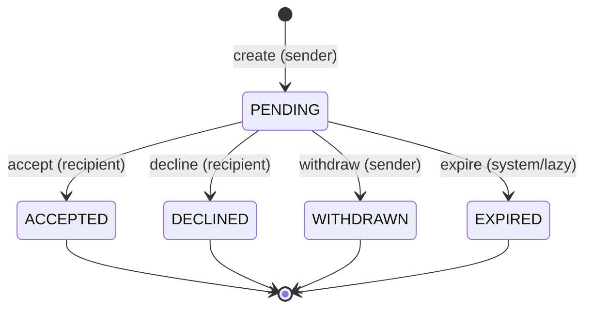

# Task 028B — Personal meetup policy proposal & API contract design

**Date:** 2026-10-29  
**Phase:** **028B COMPLETE** — documentation only; **NOT OWNER-APPROVED**. **STOP before 028C.**  
**Prerequisites:** 028A audit complete  
**Deliverables:**

| Document | Role |
|---|---|
| `docs/decisions/D-28-personal-meetup-invitation-PROPOSAL-2026-10-29.md` | Policy + state machine |
| `docs/product/MEETUP_INVITATION_API_CONTRACT_DRAFT.md` | Prisma + REST + DTO draft |
| `docs/plans/TASK_028B_OWNER_DECISION_CHECKLIST.md` | Owner sign-off rows |
| `docs/product/FIGMA_DISCOVER_MEETUP_PARITY_TASK028A.md` | Updated §028B contract notes |

---

## 1. Summary

028B converts 028A gaps into a **minimal 1:1 meetup invitation** design aligned with existing Discovery, Social, Task 022 gates, and Task 023 notification patterns — **without** conflating Activity host approval (027E).

**Proposed defaults** (from owner 028B brief) are recorded in **D-28 PROPOSAL**. They are **not** marked `Accepted` until the owner completes the checklist.

---

## 2. State machine (exact allowed transitions)

See D-28 §5. Diagram:

**Forbidden in MVP:** any transition from non-`PENDING` states; `reschedule`; participant cancel after `ACCEPTED` (unless owner adds `CANCELLED` later).

---

## 3. Authorization matrix (proposed)

| Operation | Sender | Recipient | Other |
|---|---|---|---|
| Create (to recipient) | ✓ (KYC+activation) | — | ✗ |
| List incoming | ✓ (own sent) | ✓ | ✗ |
| List outgoing | ✓ | ✓ (own received) | ✗ |
| Detail | ✓ | ✓ | **404** |
| Accept | ✗ | ✓ | **404** |
| Decline | ✗ | ✓ | **404** |
| Withdraw | ✓ (if PENDING) | ✗ | **404** |

Every handler re-validates: `hasHomeAccess`, block state, target/sender discoverability where applicable, KYC on send/accept.

---

## 4. HTTP semantics summary

| Situation | Code |
|---|---|
| Not sender/recipient | **404** (generic) |
| Blocked either direction | **404** on read; **404** or **403** on mutate (recommend **404** consistent with D-03) |
| Wrong role (e.g. sender calls accept) | **403** |
| Not `PENDING` / expired | **409** |
| Idempotent repeat accept | **200** |
| Validation failure | **400** |
| Rate limit | **429** |

---

## 5. Venue redaction (contract alignment)

Implemented in mapper layer (`meetup-invite.mapper.ts` — **future**):

- Function `redactVenueForViewer(invite, viewerRole, status)` encodes D-28 §6 table.
- List endpoint uses stricter redaction (no address in cards).

---

## 6. Expiry & cancellation (owner decisions pending)

| Topic | 028B recommendation | Status |
|---|---|---|
| Auto-expire when meetup start passes | Yes for `PENDING` | **PROPOSED** |
| Separate `expiresAt` before meetup | Optional product choice | **NEEDS DECISION** |
| Cancel after `ACCEPTED` | Not in MVP | **NEEDS DECISION** |
| Post-decline re-invite cooldown | Env off by default | **NEEDS DECISION** |

---

## 7. Notifications (design only — 028G)

Proposed types listed in D-28 §9. **028C–E must not** add enum values until migration plan approved.

Push: generic copy only in payload; `PUSH_ENABLED=false` unchanged.

---

## 8. Smallest safe **028C** implementation scope (conditional)

**Gate:** Owner checklist ≥ all **P0** rows accepted (or revised and re-documented).

| In 028C | Out of 028C |
|---|---|
| Prisma model + migration (additive) | HTTP routes |
| TS state machine + policy unit tests | Notification enum |
| No change to `ActivityParticipation` | Capability `LIVE` |
| No change to DM tables | Integration tests requiring API |

Estimated new files (implementation phase): `meetup-invite-state.ts`, `meetup-invite-policy.ts`, `meetup-invite.types.ts`, tests `meetup-invite-state.test.ts`.

---

## 9. MDWQ reconciliation (028B)

| ID | 028B update |
|---|---|
| MDWQ-0720 | Proposal documented; remains **DECISION_REQUIRED** until owner signs D-28 |
| MDWQ-0721 | Contract draft satisfies design half; stays **TECHNICAL_PENDING** until 028C+ |
| MDWQ-0722 | Pre/post-accept redaction **proposed** in D-28 §6 |
| MDWQ-0723 | State machine **proposed** in D-28 §5 |
| MDWQ-0724 | Reschedule **unchanged OWNER_DEFERRED** |
| MDWQ-0725 | 200-char note + IANA TZ **proposed**; duration/end **NEEDS DECISION** |
| MDWQ-0506 | Event list **proposed**; still deferred until 028G |
| MDWQ-0728 | **NEW:** 028B contract design **COMPLETED** (this phase) |

---

## 10. STOP

**028B complete.** No code, migrations, tests, OpenAPI, Flutter, or production changes. **Do not start 028C** without explicit owner approval of D-28 (checklist).
